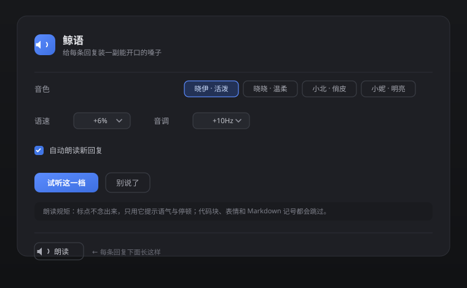

# 鲸语 · dsh-whale-voice

[](LICENSE)
[](https://github.com/deepseek-ai)

> 给 [DeepSeek Harness](https://github.com/deepseek-ai) 装一副「海星」式的嗓子。

把微软 **edge-tts** 的神经语音接进 Harness：设置页里调音色、语速、音调，每条助手回复下面多一个
**🔊 朗读** 按钮，也可以开自动朗读，让新回复自己念出来。

语音完全在**你本机**的 Python 子进程里合成，只有要朗读的文字会发给微软的语音服务，不经过任何第三方中转。



## 安装 / 更新

> **本插件没有发布到 npm，也没有上架任何插件市场。**
> 所以「添加插件」对话框里**填包名（`dsh-whale-voice`）是装不上的**——那个输入框只有走 npm 时才认包名。
> 请用下面两种方式之一：填 **GitHub 仓库地址**，或先克隆到本地再填**目录路径**。

### 方式一：填 GitHub 地址

在 **Add plugin** 对话框里粘贴仓库地址，点 **Install**：

```text
https://github.com/LSX129/dsh-whale-voice
```

装完之后补一次 Python 依赖（仓库不提交第三方代码）：

```bash
cd "<插件目录>"
py -m pip install --upgrade --target pylibs edge-tts    # macOS / Linux: python3 -m pip ...
```

> 插件目录一般在 `~/.dsh/profiles/<profile>/node_modules/dsh-whale-voice`
> （Windows：`C:\Users\<你>\.dsh\profiles\<profile>\node_modules\dsh-whale-voice`）。

### 方式二：克隆到本地再装

```bash
git clone https://github.com/LSX129/dsh-whale-voice.git
cd dsh-whale-voice
py -m pip install --upgrade --target pylibs edge-tts
```

然后在 **Add plugin** 里填这个目录的绝对路径，例如 `D:\tools\dsh-whale-voice`。

> Windows 上 `py` 是 Python 官方启动器；用别的解释器就换成你自己的 `python`。
> 仓库里也带了等价脚本 `node scripts/setup.mjs`——它会顺带处理 pip 跨盘移动的临时目录问题，有 Node 环境时更稳。

### 装完重载

把「鲸语」**关掉再打开**重载一次（只改文件不重载不生效），刷新页面，打开 **设置 › 鲸语**，挑一个音色、点「试听这一档」。

### 更新

没有 npm 包，所以 `update <包名>@latest` 那条命令用不上。直接拉代码：

```bash
cd <插件目录>
git pull
py -m pip install --upgrade --target pylibs edge-tts
```

然后再关掉再打开一次。

卡住了看下面的[详细安装](#详细安装)和[已知限制](#已知限制)。

---

## 特性

- **四个中文女声**，默认「晓伊·活泼」，最接近 DeepSeek 网页版「海星」的音色气质。
- **设置页实时生效**：音色 / 语速 / 音调改完，下一次朗读立刻换声，不用重启。
- **每条回复一个朗读按钮**：朗读 → 准备中… → 别说了，三态一眼可见；播放中再点就是停。
- **自动朗读**：打开后新到的回复自动念（页面刚打开时挂载的历史消息不念）。
- **同一条二次点击走缓存**，不再重复等合成。
- **朗读稿清洗**：标点不念出声、代码块整段跳过、链接只念标题、emoji 与 Markdown 记号都跳过。
- **自带音色降级**：配置里存了已删除的音色也会回落到默认，不会哑火。

## 详细安装

前置条件：**DeepSeek Harness 桌面版**，以及 **Python 3.8+**（Windows 上用 `py` 启动器也行）。

### 1. 取回代码

```bash
git clone https://github.com/LSX129/dsh-whale-voice.git
```

### 2. 装 Python 依赖（只需一次）

仓库不提交第三方 Python 代码（体积大、许可各异），克隆后跑一次：

```bash
py -m pip install --upgrade --target pylibs edge-tts
```

有 Node 环境的话也可以用仓库自带的等价脚本（会顺带处理 pip 跨盘移动的临时目录问题）：

```bash
npm run setup                 # 等价于 node scripts/setup.mjs
```

默认装进插件目录下的 `pylibs/`。如果插件目录只读，改用用户目录：

```bash
node scripts/setup.mjs --user     # → ~/.dsh/whale-voice/pylibs
```

已经在自己全局 Python 里装过 `edge-tts` 的话，也可以跳过这步——插件在包里和用户目录都找不到
`pylibs/` 时，会退回使用系统 Python 自己的环境。

### 3. 装进 Harness

把它作为一个 bundle 装进当前 profile（用插件管理里的「从本地目录安装」，指向 clone 下来的目录），
然后**重载该插件**并刷新页面。

### 4. 打开设置

**设置 › 鲸语**，选个音色，点「试听这一档」听听像不像。想让它自己念，就勾上「自动朗读」。

## 配置项

| 字段 | 默认 | 说明 |
| --- | --- | --- |
| 音色 | `zh-CN-XiaoyiNeural` | 晓伊·活泼；`XiaoxiaoNeural` 晓晓·温柔；`XiaobeiNeural` 小北·俏皮；`XiaoniNeural` 小妮·明亮。 |
| 语速 | `+6%` | 比标准语速略快一点，更接近真人说话的节奏。 |
| 音调 | `+10Hz` | 略抬高，少女感更足。 |
| 自动朗读 | 关 | 开启后新回复自动播。 |
| Python | 空 | 留空依次试 `py` / `python`（Windows）或 `python3` / `python`。 |
| 依赖目录 | 空 | 留空按「包内 `pylibs/` → `~/.dsh/whale-voice/pylibs` → 系统环境」的顺序找。 |

## 工作原理

```
浏览器（lib/client.js）              宿主（lib/index.mjs）              Python（tts.py）
  assistant-actions 按钮  ──POST──▶  /api/whale-voice/speak
                                       └ sessionController.events()
                                         取 assistant/message 正文
                                       └ 清洗 → prepareSpeechText()
                                                         ──stdin──▶  edge_tts.Communicate
  <Audio> 播放  ◀──audio/mpeg──  返回 mp3  ◀──stdout+文件──
```

- 浏览器侧的 `conversation.chat.assistant-actions` 插槽只给 `messageId`，拿不到消息正文，
  所以正文统一由宿主从会话事件流里取（新版宿主用 `sessionController.events()`，旧版回退
  `inspect(sessionId)`）。
- 合成走独立子进程，依赖放在插件自己的目录里，不和用户的全局 Python 环境打架。

### HTTP 接口

| 方法 | 路径 | 说明 |
| --- | --- | --- |
| `GET` | `/api/whale-voice/voices` | 音色清单 |
| `GET` | `/api/whale-voice/config` | 当前生效设置 |
| `POST` | `/api/whale-voice/say` | `{ text }` → `audio/mpeg` |
| `POST` | `/api/whale-voice/speak` | `{ sessionId, messageId? }` → `audio/mpeg` |

## 朗读规矩

这条规矩写在 `lib/index.mjs` 的 `prepareSpeechText()` 里，`/say` 和 `/speak` 都经过它：

- **标点不发音**：`。，！？；：……——` 原样交给 edge-tts，只用来定语气和停顿，不会被念成「句号」「逗号」。
- 代码块整段跳过；行内代码只念里面的字。
- 链接只念标题，图片直接丢掉。
- Markdown 记号（`#`、`*`、`_`、`>`、列表符号）和 emoji 都不念。
- 连续标点（`！！！`、`？？？`、`。。。`）并成一个，免得一句话停三次。

## 已知限制

- 首次朗读会比后面慢半拍（Python 进程冷启动 + TLS 握手），之后同一条走缓存。
- 单条回复超过 4000 字会被截断，避免一条消息念上好几分钟。
- 需要联网：edge-tts 调用的是微软的在线语音服务。
- 只在 Windows + DSH 桌面版上实测过；macOS / Linux 用 `python3` 应该也能跑，但没有验证。

## 开发

```
lib/index.mjs     host 半：配置声明、HTTP 路由、会话正文提取、朗读稿清洗
lib/client.js     web 半：设置页 + 消息朗读按钮（浏览器端模块，手写 createElement）
tts.py            合成 worker：stdin 收 JSON，stdout 回结果
scripts/setup.mjs 依赖安装
locale/           zh / en 文案
cordis.patch.yml  bundle 声明
```

改完 host 代码需要**重载插件**才生效；改 client 代码刷新页面即可。

## 许可

本仓库代码采用 **MIT**。

运行时会从 PyPI 安装 `edge-tts`（LGPL-3.0）及其依赖（`aiohttp` Apache-2.0 等），
这些第三方包**不随本仓库分发**，遵循各自的许可。

本项目与微软、DeepSeek 均无关联。

---

## English

**dsh-whale-voice** — a text-to-speech plugin for DeepSeek Harness. It wires Microsoft
edge-tts neural voices into the harness: pick a voice, rate and pitch under *Settings › 鲸语*,
and every assistant message gets a **🔊 Read aloud** button (plus optional auto-speak).

Requires Python 3.8+. Run `py -m pip install --upgrade --target pylibs edge-tts` once (or
`npm run setup`) to install the Python dependencies into `pylibs/`, install this directory as a
bundle into your Harness profile, then reload and refresh. Audio is synthesized locally; only the text to be spoken is sent to Microsoft's
speech service. Licensed MIT.
